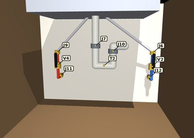
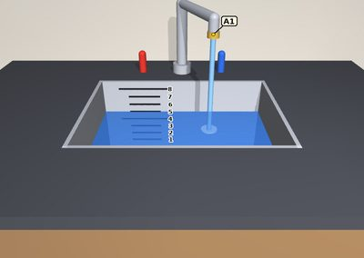
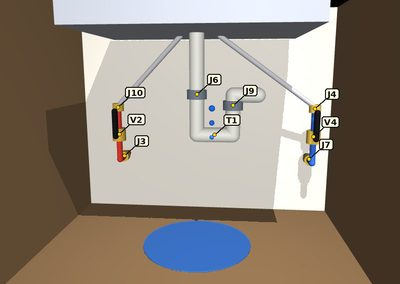

# PlumberBench

**AI can solve olympiad maths. Can it fix a leaky pipe?** An agent is called out to a house with hidden plumbing faults, sees it only in pictures, and has to look, test, diagnose and repair without flooding it, then know when the job is really done.

<p>



</p>

The fault is hidden; only a test shows it; every test costs time and can flood the floor. Built for AfterQuery's *Break the Agent* challenge at Junction 2026, as a Harbor environment that any agent can play over MCP. Pitch and results: [plumberbench.org](https://plumberbench.org); play it yourself: [plumberbench.org/play](https://plumberbench.org/play/).

## Results

On level 5, the level built to test knowing when the job is done, two of four Claude models fix the house and two report it done with faults still in it:

| Pictures only | Level 1 | Level 3 | Level 4 | Level 5 | Level 5 clean jobs |
|---|---|---|---|---|---|
| Reference plumber (scripted, 100 houses per level) | 0.96 | 0.95 | 0.94 | 0.94 | 100 of 100 |
| Claude Fable 5.2 | 0.95 | 0.93 | 0.94 | 0.94 | 2 of 2 |
| Claude Opus 5.5 | 0.94 | 0.93 | 0.93 | 0.94 | 2 of 2 |
| Claude Haiku 5.5 | 0.86 | 0.91 | 0.90 | 0.69 | 1 of 2 |
| Claude Sonnet 5.5 | 0.95 | 0.92 | 0.92 | 0.54 | 0 of 2 |
| Codex, default model | 0.90 | 0.68 | 0.58 | – | – |
| Servicing every part, never testing (100 houses) | 0.41 | 0.43 | 0.51 | 0.71 | 39 of 100 |
| Five exploits (do nothing, finish at once, name every fault, close the main, repair everything) | 0 | 0 | 0 | 0 | 0 |

A **clean job** fixes every fault, leaves nothing worse, names the faults right and reports done. The models played one or two houses per level, so read these as examples rather than estimates. Claude models ran as Claude Code subagents through [`scripts/pb`](scripts/pb), Codex through the Codex CLI over MCP; neither is the OpenCode harness the benchmark is meant to be run with. All rows: [`results/`](results/); how they were run: [docs/models.md](docs/models.md).

## Run it

Needs Docker with `docker compose`, Harbor 0.26 (`uv tool install harbor`) and a model key in the environment.

```bash
harbor run --repo valuhaka/plumberbench -d plumberbench-hard -a opencode -m anthropic/MODEL --ak disable_web_search=true
```

That runs the ten level 5 houses, pictures only. `-d plumberbench` runs all 100 (levels 1–5, ten seeds each, with and without a `FACTS` list); `-d plumberbench-smoke` first checks that pictures reach the model. The public houses are a development set: to grade, generate private ones ([docs/harbor.md](docs/harbor.md)).

Play a house yourself, no Docker or clone needed:

```bash
uvx --from git+https://github.com/valuhaka/plumberbench plumberbench-web
```

## What it tests

| | |
|---|---|
| **World model** | Faults are inside the pipes. The only way to find them is to act and compare what happens with what should: run a tap, watch a drain, open a joint over a bucket. |
| **Context** | Five views in three rooms, one picture at a time; one fault hides another until it is fixed. |
| **Knowing when you are done** | At level 5 the number of faults varies and nothing gives it away, a weak washer starts dripping only after its valve has been open a while, and a half-blocked trap shows only with both taps running. |
| **Perception** | In `vision` mode the agent gets pictures and sounds only; at level 5 a loose nut or a crusted aerator is shown in the close-up, not told. |
| *Not hands* | Every action is one MCP tool call. |

Levels 1–4 add faults, faults hidden behind others, vague complaints and decoys; level 5 closes the shortcuts they leave open (the [known shortcuts](docs/design.md#known-shortcuts)), with every rule stated in its instruction and each change checked for fairness: agents should lose because the job is hard, never because the tools hide something.

## Scoring

```
score  = repair x (0.70 + 0.15 x dryness + 0.10 x time left + 0.05 x diagnosis)
repair = faults fixed / faults present - 0.25 per part left worse
```

The verifier replays the logged actions from the seed in its own container, so a result cannot be edited into a higher reward, and a whole-house test must agree with the score. Since a flooded but complete repair still scores 0.70, the result also says whether the job was clean. [docs/design.md](docs/design.md) has the house, the tools, the levels and why the exploits fail.

## Repository

```
src/plumberbench/      the simulator, renderer, MCP server, verifier and reference solver; tools for people and models
harbor/tasks/          the 100 Harbor tasks (generated by plumberbench.tasks), named in registry.json
harbor/smoke-vision/   checks that pictures reach the model
pb_agents/             baseline agents for Harbor
results/               the difficulty ladder and model runs
scripts/               checks, and pb, a client for agents that bring their own loop
site/, worker/         the website, its Cloudflare Worker, and the one behind online play (with Dockerfile)
tests/                 142 tests; docs/ the details
```

## Develop

```bash
git clone https://github.com/valuhaka/plumberbench && cd plumberbench && ./scripts/check.sh
```

`check.sh` runs the tests and the difficulty ladder. [AGENTS.md](AGENTS.md) has the rules for changing things.

## License

MIT, see [LICENSE](LICENSE).
